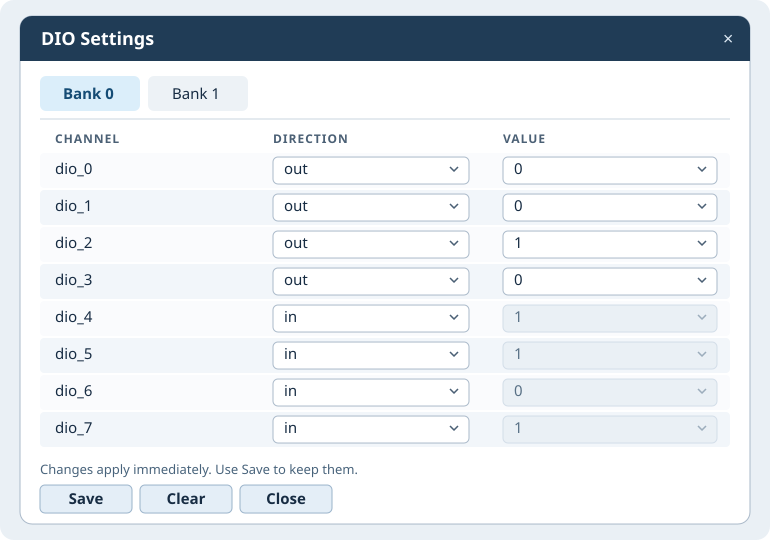

# dioctl.sh User Guide

`dioctl.sh` reads and configures Linux GPIOs through the `dio-sysfs` driver. It automatically discovers bound banks. Each bank has eight channels, `dio_0` through `dio_7`.

## Getting started

Place `dioctl.sh` in your working directory. Load the driver and verify that the DIO devices are bound.

```sh
sudo dioctl.sh --help
sudo dioctl.sh status
```

## Check bank status

```sh
sudo dioctl.sh status      # Show every channel in every detected bank
sudo dioctl.sh status 2    # Show dio_2 in each detected bank
```

`status` groups the `CHANNEL`, `DIRECTION`, and `VALUE` columns by bank. Channel numbers are local to each bank. For example, `--bank 1 get 0` reads `dio_0` on bank 1.

## Configure and save GPIO settings

Use `--bank 0` or `--bank 1` before a command that targets a single bank when both banks are present. If only one device is detected, you can omit `--bank`.

```sh
# Read the direction and value of dio_2 on bank 1
sudo dioctl.sh --bank 1 get 2 direction
sudo dioctl.sh --bank 1 get 2 value

# Set dio_2 to output with an initial value of 1
sudo dioctl.sh --bank 1 set 2 out 1

# Set the output value of dio_2 to 0 and configure dio_4 as input
sudo dioctl.sh --bank 1 value 2 0
sudo dioctl.sh --bank 1 set 4 in

# Save all eight channel settings for bank 1
sudo dioctl.sh --bank 1 save

# Clear the saved settings for bank 1
sudo dioctl.sh --bank 1 clear
```

| Command | Description |
|---|---|
| `status [CHANNEL]` | Show all detected banks, optionally filtered by channel number. |
| `get CHANNEL [direction\|value]` | Read the selected attribute. The default is `value`. |
| `set CHANNEL in` | Configure the channel as an input. |
| `set CHANNEL out [0\|1]` | Configure the channel as an output, optionally with an initial value. |
| `set CHANNEL high\|low` | Configure an output and set it high or low. |
| `set CHANNEL 0\|1` | Set the value of a channel that is already an output. |
| `direction CHANNEL in\|out\|high\|low` | Set the direction or configure an output level. |
| `value CHANNEL [0\|1]` | Read the value or write it when the channel is an output. |
| `save` | Persist all eight channel settings for the selected bank through the driver. |
| `clear` | Clear the selected bank's saved settings. Active GPIO settings stay in effect. |
| `gui` | Open the graphical interface for all detected banks. |

GPIO changes take effect immediately. Run `save` to persist them. On the next module load, `modprobe` reads the options saved by the driver.

## Graphical interface

```sh
sudo dioctl.sh gui
```



The illustration is a mockup. Colors and control styling vary with the desktop theme.

1. Select **Bank 0** or **Bank 1** to view its eight channels. A single detected bank opens directly.
2. Choose `in` or `out` from the **DIRECTION** dropdown. Switching to `out` starts the channel at `0`.
3. Choose `0` or `1` from **VALUE** for an output. For an input, the field displays the measured value and is read-only.
4. Changes take effect immediately, and the row updates from GPIO readback. The active tab polls direction and value every 500 ms. An open dropdown pauses polling for its row until it closes.
5. **Save** persists the active bank's settings, **Clear** clears that bank's saved settings, and **Close** exits. If `sudo` requests a password, enter it in the terminal where you started the GUI.

## Troubleshooting

| Symptom | What to check |
|---|---|
| No DIO devices found | Verify that the module is loaded and the Device Tree nodes are bound. List bound devices with `ls -l /sys/bus/platform/drivers/dio-sysfs/`. |
| A single-bank CLI command reports multiple banks | Put `--bank 0` or `--bank 1` before the command. Use `status` to view all banks. |
| The GUI does not open | Install the GUI dependencies and run the command from a terminal in a graphical desktop session. |
| A write fails or the readback differs from the selection | Check the terminal for permission or driver errors, then check the channel direction and hardware signal. |

