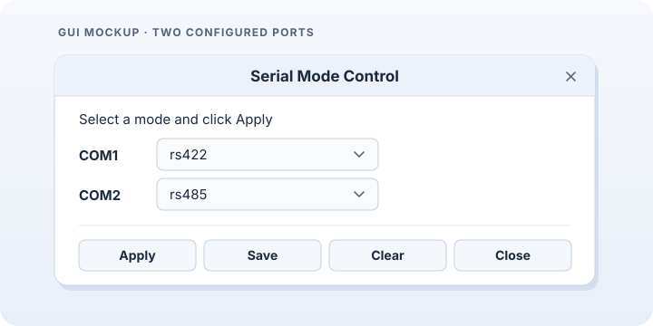

# serial_mode_ctl.sh

`serial_mode_ctl.sh` is a Linux userspace utility for F81435 and SP339E serial transceivers. It detects devices bound to either mode control driver and lets you view, change, save, or reset COM port modes. Supported modes are `rs232`, `rs422`, and `rs485`.

The utility configures the electrical mode of the transceiver. Set baud rate, framing, and data transfer separately through the corresponding UART device.

## Command-line usage

```text
serial_mode_ctl.sh [--sysfs DIR] COMMAND
```

| Command | Description |
|---|---|
| `get [COM]` | Show the current mode of `com1` or `com2`. Omit COM to list all available ports. |
| `set COM MODE` | Change the specified port immediately without saving it. |
| `save` | Save the current modes of all configured ports. |
| `clear` | Delete the saved configuration and immediately restore the Device Tree (DT) defaults. A port without a DT default returns to `rs232`. |
| `gui` | Open the GTK settings window. |
| `--help` | Show command usage. |

```bash
sudo serial_mode_ctl.sh get
sudo serial_mode_ctl.sh set com1 rs422
sudo serial_mode_ctl.sh get com1
sudo serial_mode_ctl.sh save
```

To restore the defaults, run `sudo serial_mode_ctl.sh clear`.

You do not need to specify the chip name. If multiple devices are detected, the CLI lists their paths. Use `--sysfs DIR` to select one:

```bash
sudo serial_mode_ctl.sh --sysfs /sys/bus/platform/devices/sp339e_mode_ctrl/sp339e get
```

Replace the example path with the actual device directory containing `com1_mode` or `com2_mode`.

## GTK graphical interface

```bash
sudo -v
serial_mode_ctl.sh gui
```

The GUI uses cached sudo authorization to access sysfs. If authorization expires, run `sudo -v` again in the same terminal. The GUI does not require Zenity or pkexec, and CLI commands do not require GTK.



*Illustration, not a screenshot. Both rows appear only when both ports are configured. A device selector appears above the port settings when multiple devices are detected.*

Each dropdown initially shows the mode reported by the driver. Select a mode for each port you want to change.

| Button | Behavior |
|---|---|
| **Apply** | Apply the selected modes immediately without saving them. |
| **Save** | Show the modes selected in the dropdowns. Click **OK** to apply and save them without clicking **Apply** first. **Cancel** leaves the settings unchanged. |
| **Clear** | Show the current modes reported by the driver. Click **OK** to delete the saved configuration and restore the DT defaults. **Cancel** leaves the settings unchanged. |
| **Close** | Close the window. |

After a successful operation, the GUI reads sysfs again and updates the dropdowns. If a mode change fails during **Save**, the utility does not write the saved configuration. Any port changes that already succeeded remain active.

## Saved settings and troubleshooting

The driver manages the saved configuration:

| Driver | Configuration file |
|---|---|
| F81435 | `/etc/modprobe.d/f81435-mode.conf` |
| SP339E | `/etc/modprobe.d/sp339e-mode.conf` |

The settings take effect the next time the module is loaded through `modprobe`. Loading it directly with `insmod` does not read this file. On systems with multiple devices of the same chip type, `--sysfs` selects the device to operate on; the saved configuration file is shared by that driver.

- **No device found:** Check that the driver is loaded and bound. Look for probe messages in `dmesg`.
- **COM2 is missing:** Verify that the port is configured in the Device Tree and that the driver exposes `com2_mode`.
- **Read or write fails:** Check sysfs permissions, sudo authorization, and driver messages. CLI exit codes are `0` for success, `1` for a device or I/O failure, and `2` for invalid usage.

